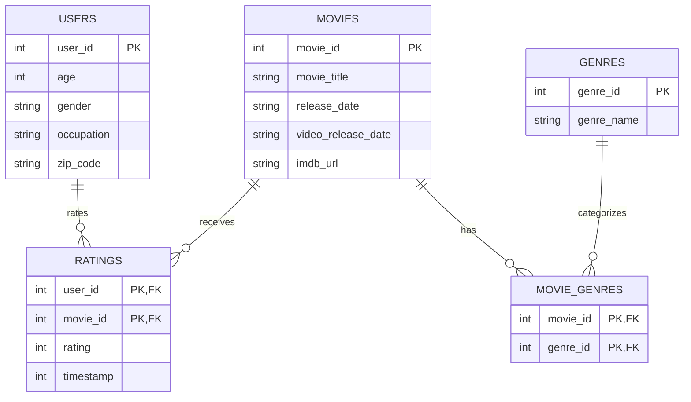

Step 1

Data Provenance
**Source U**: `https://files.grouplens.org/datasets/movielens/ml-100k.zip **Download De**: 2026-10-28 09:15:- **SHA-256 Checum**: `50d2a982c66986937beb9ffb3aa76efe955bf3d5c6b761f4e3a7cd717c

Step 2(a)

Step 2(b)

Storing Genres in Tidy Form:
  Instead of retaining 19 separate binary columns (`genre_0`, `genre_1`, etc.) in the `movies` table, the schema uses a junction table (`movie_genres`). This unpivots the data into a normalized (long) structure, satisfying First Normal Form (1NF). It avoids storing redundant sparse zeros and lets you add new genres in the future without changing the database schema.

Step 2(c)

Constraints & Unenforced Claims:

Enforced by constraints (sql/schema.sql):
- Ratings are 1–5 (README): CHECK (rating BETWEEN 1 AND 5)
- User IDs are 1–943 and movie IDs are 1–1682 (README): CHECK ... BETWEEN
- Timestamps are Unix seconds (README): CHECK (timestamp > 0)
- Genre IDs are 0–18 (u.genre file): CHECK (genre_id BETWEEN 0 AND 18)
- Occupation is one of the 21 in u.occupation: CHECK (occupation IN (...))
- Gender is M or F (observed in the data; the README only names the field): CHECK (gender IN ('M','F'))
- Every rating points to a real user and movie: FOREIGN KEY constraints

Claims no constraint can enforce, checked with queries after loading (Step 4):
- IDs are consecutive with no gaps: compare COUNT(*) with MAX(id).
- Every user rated at least 20 movies: GROUP BY user_id HAVING COUNT(*) < 20 should return no rows.

Step 2(d)

Data Type for `zip_code`:
  The `zip_code` field is typed as `TEXT` (or `VARCHAR`) rather than `INTEGER`. This is necessary because:
  1. Standard numerical types strip leading zeros (e.g., U.S. ZIP code `02138` would incorrectly become `2138`).
  2. 18 users have non-numeric postal codes (e.g., `E2A4H`, `T8H1N`, `V3N4P`). As INTEGER, these values could not be stored at all: under a STRICT table SQLite would refuse those rows, and a non-STRICT table would quietly store them as text in a numeric column.