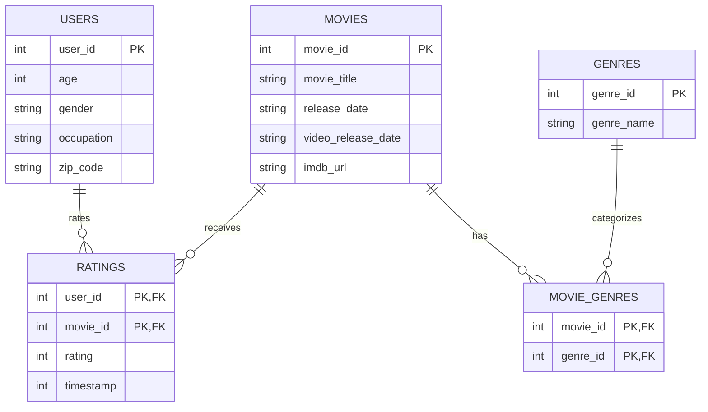

Step 1

Data Provenance
**Source U**: `https://files.grouplens.org/datasets/movielens/ml-100k.zip **Download De**: 2026-10-28 09:15:- **SHA-256 Checum**: `50d2a982c66986937beb9ffb3aa76efe955bf3d5c6b761f4e3a7cd717c


Step 2(a)





Step 2(b)


Storing Genres in Tidy Form:
  Instead of retaining 19 separate binary columns (`genre_0`, `genre_1`, etc.) in the `movies` table, the schema uses a junction table (`movie_genres`). This unpivots the data into a normalized (long) structure, satisfying First Normal Form (1NF). It avoids storing redundant sparse zeros and lets you add new genres in the future without changing the database schema.


Step 2(c)


Constraints & Unenforced Claims:

Enforced by constraints (sql/schema.sql):
- Ratings are 1–5 (README): CHECK (rating BETWEEN 1 AND 5)
- User IDs are 1–943 and movie IDs are 1–1682 (README): CHECK ... BETWEEN
- Timestamps are Unix seconds (README): CHECK (timestamp > 0)
- Genre IDs are 0–18 (u.genre file): CHECK (genre_id BETWEEN 0 AND 18)
- Occupation is one of the 21 in u.occupation: CHECK (occupation IN (...))
- Gender is M or F (observed in the data; the README only names the field): CHECK (gender IN ('M','F'))
- Every rating points to a real user and movie: FOREIGN KEY constraints

Claims no constraint can enforce, checked with queries after loading (Step 4):
- IDs are consecutive with no gaps: compare COUNT(*) with MAX(id).
- Every user rated at least 20 movies: GROUP BY user_id HAVING COUNT(*) < 20 should return no rows.


Step 2(d)


Data Type for `zip_code`:
  The `zip_code` field is typed as `TEXT` (or `VARCHAR`) rather than `INTEGER`. This is necessary because:
  1. Standard numerical types strip leading zeros (e.g., U.S. ZIP code `02138` would incorrectly become `2138`).
  2. 18 users have non-numeric postal codes (e.g., `E2A4H`, `T8H1N`, `V3N4P`). As INTEGER, these values could not be stored at all: under a STRICT table SQLite would refuse those rows, and a non-STRICT table would quietly store them as text in a numeric column.


# MovieLens 100K in SQLite (DS5110 Homework 3)

Loads the GroupLens MovieLens 100K dataset into a SQLite database whose schema
enforces the dataset README's claims, then answers questions about it in SQL.

## How to run

```bash
make
```

`make` downloads the data into `raw/` if it is missing, rebuilds
`data/movielens.db` from scratch, and writes refused rows to
`output/rejected.csv`.

The tables are STRICT, which needs SQLite 3.37 or newer. Check yours with
`python3 -c "import sqlite3; print(sqlite3.sqlite_version)"`. If it is older,
run `make PYTHON=python` with a newer Python (for example a conda environment).

Run any query, for example:

```bash
python -c "import sqlite3; print(sqlite3.connect('data/movielens.db').execute(open('sql/queries/q1_top10_most_rated.sql').read()).fetchall())"
```

## Data source

- **Dataset:** MovieLens 100K, GroupLens Research, University of Minnesota
- **URL:** https://files.grouplens.org/datasets/movielens/ml-100k.zip
- **Downloaded:** 2026-10-28
- **SHA-256 of the zip:** `50d2a982c66986937beb9ffb3aa76efe955bf3d5c6b761f4e3a7cd717c6a3229`

The data is not committed. Its license does not allow redistribution, so
`src/download.py` fetches it and `raw/` is in `.gitignore`. Cite:
F. Maxwell Harper and Joseph A. Konstan. 2015. The MovieLens Datasets: History
and Context. ACM TiiS 5, 4, Article 19. https://doi.org/10.1145/2827872

## Schema


## Repository layout

| Path | What it is |
|---|---|
| `src/download.py` | Downloads and unpacks the dataset into `raw/` |
| `src/load.py` | Builds `data/movielens.db`, logs refused rows |
| `sql/schema.sql` | STRICT tables, keys and constraints |
| `sql/queries/` | One file per Step 4 claim and Step 5 question |
| `output/rejected.csv` | Rows the schema refused |
| `WRITEUP.md` | Predictions, counts and explanations |

## Use of AI assistants

Claude (Anthropic) was used to draft `src/load.py`, `src/download.py`, the
`Makefile` and the SQL query files, and to explain the syntax and reasoning
behind them. It also helped draft parts of `WRITEUP.md`. I ran every script and
query myself, checked the results against the data, and wrote the predictions.

ChatGPT was helped with understanding SQL concepts, specifically with CTE and subqueries. I also used it to explain the NOT IN vs NOT Exists because I was not sure about it. It was also used in Step 7 to help me do pandas comparisons and it was used to hep me understand code. 


## Contribution
 Ehsan responsibles for Step 0 (exploratory data analysis, charts, and README gap analysis) and Step 1 (reproducible download script and checksum logging). Handled Step 2 (schema design, Mermaid diagram, and foreign key constraints). Also contributed to drafting portions of the write-up.
