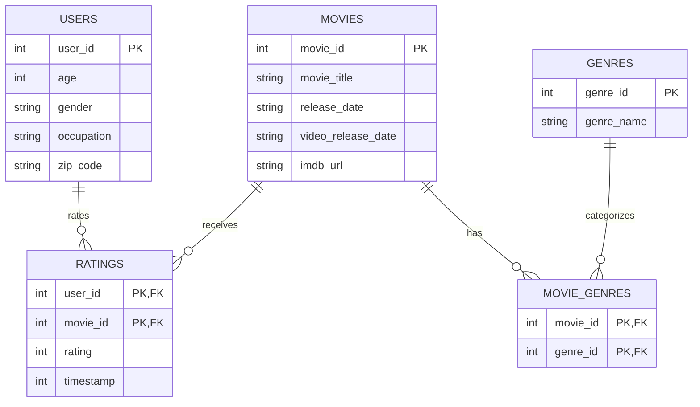

# MovieLens 100K in SQLite (DS5110 Homework 3)

Loads the GroupLens MovieLens 100K dataset into a SQLite database whose schema
enforces the dataset README's claims, then answers questions about it in SQL.

## How to run

```bash
make
```

`make` downloads the data into `raw/` if it is missing, rebuilds
`data/movielens.db` from scratch, and writes refused rows to
`output/rejected.csv`.

The tables are STRICT, which needs SQLite 3.37 or newer. Check yours with
`python3 -c "import sqlite3; print(sqlite3.sqlite_version)"`. If it is older,
run `make PYTHON=python` with a newer Python (for example a conda environment).

Run any query, for example:

```bash
python -c "import sqlite3; print(sqlite3.connect('data/movielens.db').execute(open('sql/queries/q1_top10_most_rated.sql').read()).fetchall())"
```

## Data source

- **Dataset:** MovieLens 100K, GroupLens Research, University of Minnesota
- **URL:** https://files.grouplens.org/datasets/movielens/ml-100k.zip
- **Downloaded:** 2026-10-28
- **SHA-256 of the zip:** `50d2a982c66986937beb9ffb3aa76efe955bf3d5c6b761f4e3a7cd717c6a3229`

The data is not committed. Its license does not allow redistribution, so
`src/download.py` fetches it and `raw/` is in `.gitignore`. Cite:
F. Maxwell Harper and Joseph A. Konstan. 2015. The MovieLens Datasets: History
and Context. ACM TiiS 5, 4, Article 19. https://doi.org/10.1145/2827872

## Schema



## Repository layout

| Path | What it is |
|---|---|
| `src/download.py` | Downloads and unpacks the dataset into `raw/` |
| `src/load.py` | Builds `data/movielens.db`, logs refused rows |
| `sql/schema.sql` | STRICT tables, keys and constraints |
| `sql/queries/` | One file per Step 4 claim and Step 5 question |
| `output/rejected.csv` | Rows the schema refused |
| `WRITEUP.md` | Predictions, counts and explanations |

## Use of AI assistants

Claude (Anthropic) was used to draft `src/load.py`, `src/download.py`, the
`Makefile` and the SQL query files, and to explain the syntax and reasoning
behind them. It also helped draft parts of `WRITEUP.md`. I ran every script and
query myself, checked the results against the data, and wrote the predictions.
